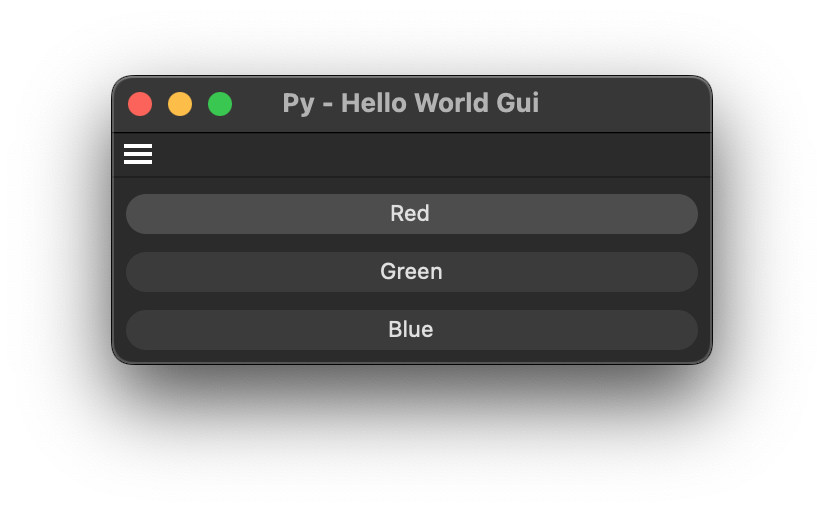

# Example py_cmd_gui_hello_world

Demonstrates the most basic command/dialog plugin possible.

## DETAILS

The command opens a small dialog with three buttons. Each button handles user input and displays a message, illustrating the basic relationship between CommandData and GeDialog.

To run this example, place the file in the Cinema 4D plugins folder and restart Cinema 4D.

Topics:
- Creating a basic dialog layout with GeDialog
- Handling button input in GeDialog.Command()
- Registering a command plugin that opens a dialog

## FILES

| File | Description |
| --- | --- |
| [py_cmd_gui_hello_world.pyp](py_cmd_gui_hello_world.pyp) | Demonstrates the most basic command/dialog plugin possible. |
| [README.md](README.md) | This file. |
| [preview.png](preview.png) | Preview image for the plugin. |
