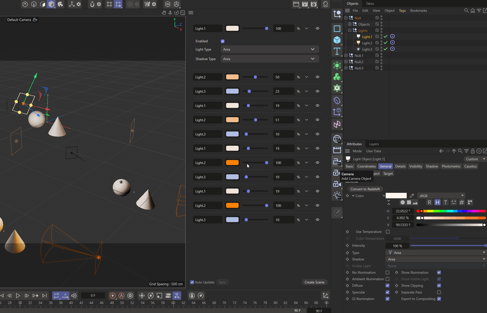

# Example py_cmd_gui_html

Demonstrates how to implement a dialog that hosts an HTML viewer and can send and receive data to/from the displayed web page.



## DETAILS

The example implements a simple light manager that tracks all standard renderer light objects in the
scene and displays their data in a web page. Data updates work bidirectionally, i.e., when the user
changes data in the web page, the scene is updated accordingly, and when the user changes data in
the scene, the web page is updated accordingly (without fully being reloaded). The example also shows
how to dynamically style the web page based on the current Cinema 4D look and feel, such as font
size, font family, and color scheme.

See #HtmlGuiDialog.OnPostMessage() for how to receive data from the web page and update the scene,
and see #HtmlGuiDialog.UpdateTrackedData() for how to gather scene data and send it to the web page.
You must also read the HTML file `res/html/light_list.html` to understand this example.

# Data Model

You can change this to your liking; this is not set in stone. But I would recommend using an
expressive 'identifying key' such as 'mxnCustomEvent', as the 'message' event is shared with other
providers on the JS side. All data is serialized to JSON strings for transport and deserialized on
the other side.

## Outgoing

```json
    {
        "mxnCustomEvent": "sendLightData",
        "sceneState": {
            "sceneHash": "<hash of the scene>",
            "objects": [
                {
                    "name": "<name of the object>",
                    "objectHash": "<hash of the object>",
                    "position": [x, y, z],
                    "color": "#RRGGBB",
                    "brightness": <float>,
                    "lightType": <int>,
                    "shadowType": <int>,
                    "isEnabled": <bool>
                },
                ...
            ]
        }
    }
```

## Incoming

```json
    {
        "mxnCustomEvent": "receiveLightData",
        "objectHash": "<hash of the object>",
        "field": "<name of the field that was changed>",
        "value": "<new value of the field>"
    }
```

To run this example, place the file in the Cinema 4D plugins folder and restart Cinema 4D.

Topics:
- Hosting an HTML viewer in a Cinema 4D dialog
- Exchanging data between HTML and Python
- Synchronizing scene lights with a web interface

## FILES

| File | Description |
| --- | --- |
| [py_cmd_gui_html.pyp](py_cmd_gui_html.pyp) | Demonstrates how to implement a dialog that hosts an HTML viewer and can send and receive data to/from the displayed web page. |
| [README.md](README.md) | This file. |
| [preview.gif](preview.gif) | Preview image for the plugin. |
| [res/html/light_list.html](res/html/light_list.html) | HTML interface displayed by the plugin dialog. |
