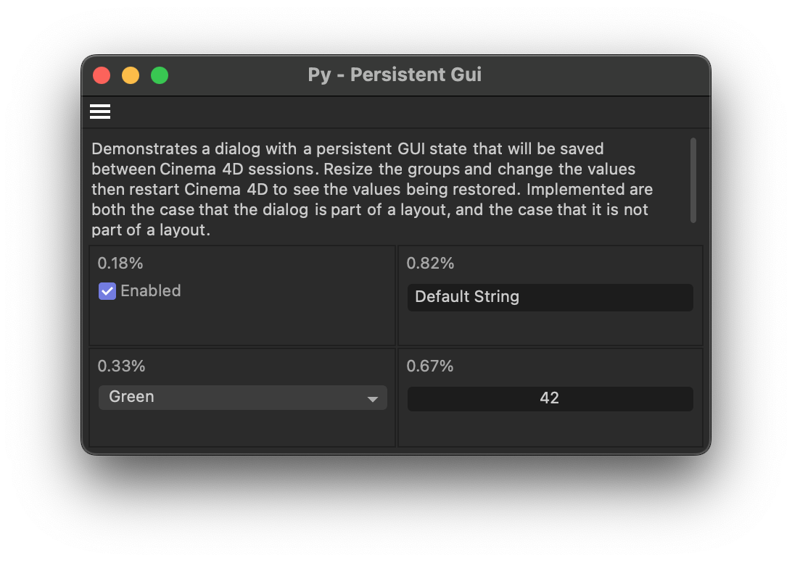

# Example py_cmd_gui_persistent

Demonstrates how to store dialog layout data and values persistently over dialog open/close
and Cinema 4D restart boundaries.

## DETAILS

Open this dialog example by running the command "Py - Persistent Gui" in the Commander (Shift + C).
The dialog contains four groups whose size can be adjusted by the user, and one GUI element
in each group. The group weights and gadget values will persist when the dialog is closed
and reopened, the user switches a layout, or when Cinema 4D is restarted.

Note:

Cinema 4D itself heavily relies on layout files these days to persistently store dialog layouts
and values. In this regard, the API is working as intended. But third party plugins often are
not part of a layout file, and therefore cannot rely on the layout file system for this purpose.

This example therefore uses custom serialization and deserialization to cover all possible
boundaries (open/close and restart) over which values should be preserved. This is only relevant
for the case when the dialog is not part of a layout file.

The relevant code sections have been marked with "@CustomSerialization", and there is also
`py_cmd_gui_persistent_no_restart.pyp` next to this example which does not use custom
serialization and deserialization, i.e., has these sections removed. The dialog data saving
will work there within layouts files and within one Cinema 4D session, but not over Cinema 4D
restart boundaries.

To run this example, place the file in the Cinema 4D plugins folder and restart Cinema 4D.

Topics:
- Layout support for dialogs via BFM_LAYOUT_GETDATA and BFM_LAYOUT_SETDATA.
- Using BFV_GRIDGROUP_ALLOW_WEIGHTS to allow the user to resize groups in a dialog.
- Using GeDialog.GroupWeightsSave() and GroupWeightsLoad() to manage group weights.
- Custom hyper file serialization and deserialization of dialog values.

## FILES

| File | Description |
| --- | --- |
| [py_cmd_gui_persistent.pyp](py_cmd_gui_persistent.pyp) | Demonstrates how to store dialog layout data and values persistently over dialog open/close and Cinema 4D restart boundaries. |
| [README.md](README.md) | This file. |
| [preview.png](preview.png) | Preview image for the plugin. |
