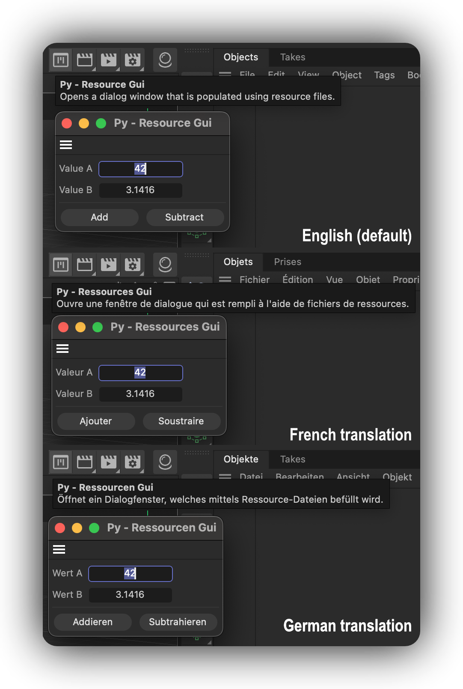

# Example py_cmd_gui_resources

Demonstrates a plugin that uses resources to define its dialog layout and string translations.



## DETAILS

Open this dialog example by running the command "Py - Resource Gui" in the Commander (Shift + C).
The dialog itself is not very complex, but it demonstrates how to use resources to define the layout
of a dialog.

Plugins store their resources in a folder named "res" next to the plugin module (the pyp file in
Python). Such a resource folder can contain a wide variety of resources, but one important aspect
are *.res, *.str, and *.h files, defining description resources (the UI types used by scene elements
such as materials, objects, and tags), and dialog resources. This example focuses on dialog
resources. A res folder for a plugin using dialog resources could look like this:

```
    myPlugin/                               # The plugin folder.
    ├── myPlugin.pyp                        # The plugin module.
    └── res/                                # The resources of the plugin.
        ├── c4d_symbols.h                   # The global symbols of the plugin; here are all non-
        │                                     description, i.e., dialog, IDs defined.
        ├── dialogs/                        # The dialog resources of the plugin; here we can find
        │   |                               # the markup that defines dialogs.
        │   ├── idd_values.res              # A dialog GUI markup file.
        │   └── idd_buttons.res             # Another dialog GUI markup file.
        ├── strings_en-US/                  # The English strings for the plugin used by resources.
        │   ├── dialogs/                    # The English dialog strings for the plugin.
        │   │   ├── idd_values.str          # The strings for the IDD_VALUES dialog.
        │   │   └── idd_buttons.str         # The strings for the IDD_BUTTONS dialog.
        │   └── c4d_strings.str             # Generic English strings for the plugin.
        └── strings_de-DE/                  # The German strings for the plugin used by resources.
             ...
```

Cinema 4D currently supports the following languages:

- en-US: English (default language, fallback when no translation is available; all plugins must
have this language defined)
- ar-AR: Arabic
- cs-CZ: Czech
- de-DE: German
- es-ES: Spanish
- fr-FR: French
- it-IT: Italian
- ja-JP: Japanese
- ko-KR: Korean
- pl-PL: Polish
- pt-BR: Brazilian Portuguese
- zh-CN: Simplified Chinese

Warning:

All languages that use non-ASCII characters, such as Chinese, French, and German, require their
special Unicode characters to be encoded as ASCII escape sequences in the *.str files. E.g.,
an '品' must become '品', an 'é' must become 'é', "ä" must become "ä", and so
on. Cinema 4D offers no built-in tool to do this, but the example script `unicode_encode_strings.py`
shipped next to this example can be a starting point for a conversion pipeline.

To run this example, place the file in the Cinema 4D plugins folder and restart Cinema 4D.

Topics:
- Defining dialog resources in a resource file.
- Loading dialog resources with GeDialog.LoadDialogResource().
- Loading string translations with c4d.plugins.GeLoadString().
- Purpose of __res__ in a plugin module and how to manually load a resource.

## FILES

| File | Description |
| --- | --- |
| [py_cmd_gui_resources.pyp](py_cmd_gui_resources.pyp) | Demonstrates a plugin that uses resources to define its dialog layout and string translations. |
| [unicode_encode_strings.py](unicode_encode_strings.py) | Provides an example for how one could realize a string encoding pipeline for plugin resources. |
| [README.md](README.md) | This file. |
| [preview.png](preview.png) | Preview image for the plugin. |
| [res/c4d_symbols.h](res/c4d_symbols.h) | Global symbols and identifiers used by the plugin. |
| [res/dialogs/idd_buttons.res](res/dialogs/idd_buttons.res) | Dialog resource markup for the plugin. |
| [res/dialogs/idd_values.res](res/dialogs/idd_values.res) | Dialog resource markup for the plugin. |
| [res/strings_de-DE/c4d_strings.str](res/strings_de-DE/c4d_strings.str) | The global German language string table used by the plugin. |
| [res/strings_de-DE/dialogs/idd_buttons.str](res/strings_de-DE/dialogs/idd_buttons.str) | The German language string table by the idd_buttons dialog. |
| [res/strings_de-DE/dialogs/idd_values.str](res/strings_de-DE/dialogs/idd_values.str) | The German language string table by the idd_values dialog. |
| [res/strings_en-US/c4d_strings.str](res/strings_en-US/c4d_strings.str) | The global English language string table used by the plugin. |
| [res/strings_en-US/dialogs/idd_buttons.str](res/strings_en-US/dialogs/idd_buttons.str) | The English language string table by the idd_buttons dialog. |
| [res/strings_en-US/dialogs/idd_values.str](res/strings_en-US/dialogs/idd_values.str) | The English language string table by the idd_values dialog. |
| [res/strings_fr-FR/c4d_strings.str](res/strings_fr-FR/c4d_strings.str) | The global French language string table used by the plugin. |
| [res/strings_fr-FR/dialogs/idd_buttons.str](res/strings_fr-FR/dialogs/idd_buttons.str) | The French language string table by the idd_buttons dialog. |
| [res/strings_fr-FR/dialogs/idd_values.str](res/strings_fr-FR/dialogs/idd_values.str) | The French language string table by the idd_values dialog. |
