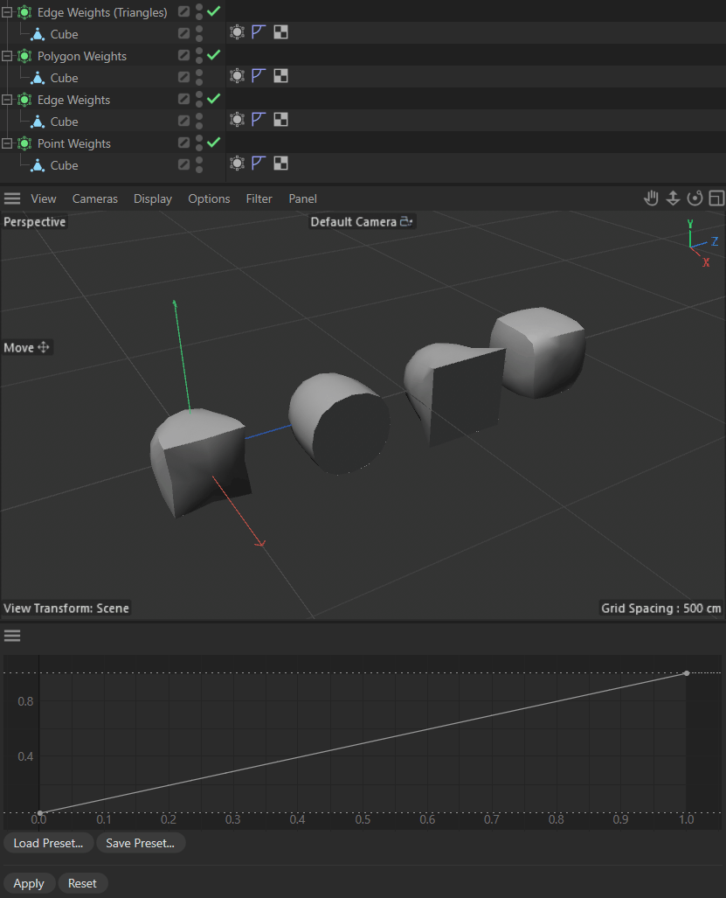

# Example py_cmd_tool_finalization

Demonstrates a tool finalization workflow at the example of editing SDS weights.

## DETAILS

Tool finalization workflow describes the practice of locking onto a snapshot of scene data and then
letting the user make rolling changes to the scene with viewport feedback. Each change is based on
the snapshot data, not the data shown in the viewport or scene, so edits do not build on previous
edits but always on the initial data. Unless the user finalizes the changes, e.g., by clicking an
"Apply" button, changes are not actually applied to the scene, and rolled back to the initial state
when the user aborts the tool directly or indirectly. This is a common workflow for tools that can
also be applied to other cases such as modelling.

Open this dialog example by running the command "Py - SDS Weighting Tool (Finalization Logic)" in the
Commander (Shift + C). The tool tracks the selection of SDS tags in the scene and lets the user
modify their weights with a spline custom GUI. Editing the spline will always use the base data,
although we apply and see the final result in the scene. Only when the user clicks the "Apply"
button, we finalize the changes and update our base data.

This example has for demonstration purposes not been implemented as an explicit ToolData plugin, but
the same principles can be applied 1:1 there too. The pure dialog approach shows that this can also
be applied to 'tools' which are not formally a tool.

To run this example, place the file in the Cinema 4D plugins folder and restart Cinema 4D.

Topics:
- Working with a snapshots of scene data for rolling changes, including undo handling.
- Tracking scene state changes via core messages

## FILES

| File | Description |
| --- | --- |
| [py_cmd_tool_finalization.pyp](py_cmd_tool_finalization.pyp) | Demonstrates a tool finalization workflow at the example of editing SDS weights. |
| [README.md](README.md) | This file. |
| [preview.gif](preview.gif) | Preview animation for the plugin. |
