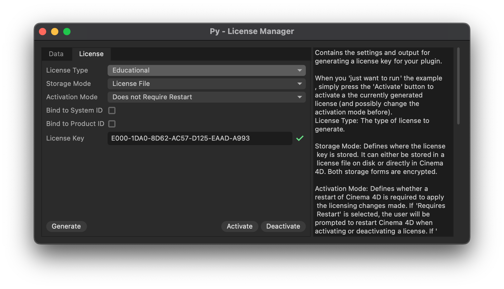

# Example py_msc_licensing

Demonstrates how to implement licensing checks in plugins.

## DETAILS

This example plugin module implements two licensable plugins: an object plugin and a command
plugin. Both plugins can be licensed using a license manager dialog that is also implemented
in this module.

Demonstrated features:
- Internalized license storage.
- File based license storage.
- Restart based activation workflow.
- No-restart based activation workflow.
- Simple hashing scheme for license keys.
- Dynamic enabling/disabling of plugin functionality based on licensing state.
- GUI based license manager dialog.

To run this example, place the file in the Cinema 4D plugins folder and restart Cinema 4D.

Topics:
- Registering licensable object and command plugins
- Validating licenses through a license manager dialog

## FILES

| File | Description |
| --- | --- |
| [py_msc_licensing.pyp](py_msc_licensing.pyp) | Demonstrates how to implement licensing checks in plugins. |
| [py_msc_licensing_simple.pyp](py_msc_licensing_simple.pyp) | Demonstrates simple licensing workflow for Python plugins in Cinema 4D. |
| [README.md](README.md) | This file. |
| [preview.png](preview.png) | Preview image for the plugin. |
| [res/c4d_symbols.h](res/c4d_symbols.h) | Global symbols and identifiers used by the plugin. |
| [res/description/Olicenseablecube.h](res/description/Olicenseablecube.h) | Description symbols for the Olicenseablecube plugin. |
| [res/description/Olicenseablecube.res](res/description/Olicenseablecube.res) | Description definition for the Olicenseablecube plugin. |
| [res/dialogs/dlg_license_manager.res](res/dialogs/dlg_license_manager.res) | Dialog resource markup for the plugin. |
| [res/strings_us/c4d_strings.str](res/strings_us/c4d_strings.str) | The global English language string table used by the plugin. |
| [res/strings_us/description/Olicenseablecube.str](res/strings_us/description/Olicenseablecube.str) | The English language string table by the Olicenseablecube description. |
| [res/strings_us/dialogs/dlg_license_manager.str](res/strings_us/dialogs/dlg_license_manager.str) | The English language string table by the dlg_license_manager dialog. |
