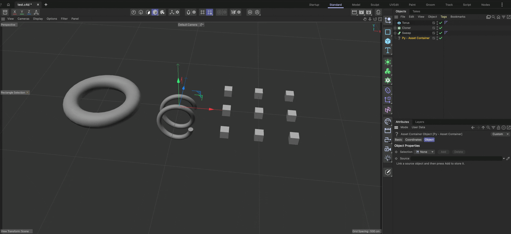

# Example py_obj_assetcontainer

Demonstrates NodeData serialization and custom branching.

## DETAILS

NodeData serialization functions let a node store, read, and copy custom data. This preserves
additional plugin data with the scene and when the node is duplicated. This example applies that
general mechanism to a custom scene-graph branch, storing objects as branch data and using them to
generate the object's output.

Cinema 4D represents its scene graph as sets of hierarchies where each node can have zero to many
relations to other hierarchies; Cinema calls these relations branches. A document, for example, is
also a node and has an object branch and a material branch, among others, which hold the objects
and materials as the user sees them in the Object and Material Managers (documents themselves are
in fact also in a hierarchy as all loaded documents are in a sibling relation). An object in a
document is also a node and can have branches for tags, tracks, and other things. A tag in turn is
also a node and can have branches for tracks, and so on. See `mxutils.GetSceneGraphString` in the
documentation for a visual overview of the scene graph and its branches. In addition to the custom
read, save, and copy operations, this example also implements a custom branch for storing and
managing scene objects, the assets hosted by the plugin.

To run this example, create a new scene, add a Py - Asset Container object, link a source object,
and press Add to store it. You can then select the stored assets from the Selection cycle. You can
delete the source object and save and reload the scene; the internalized assets will be preserved.

Topics:
- Owning a custom GeListHead branch
- Reading, writing, and copying custom data with a node
- Serializing and copying branch data
- Populating a dynamic description cycle

## FILES

| File | Description |
| --- | --- |
| [py_obj_assetcontainer.pyp](py_obj_assetcontainer.pyp) | Demonstrates NodeData serialization and custom branching. |
| [README.md](README.md) | This file. |
| [preview.gif](preview.gif) | Preview animation for the plugin. |
| [res/c4d_symbols.h](res/c4d_symbols.h) | Global symbols and identifiers used by the plugin. |
| [res/description/opyassetcontainer.h](res/description/opyassetcontainer.h) | Description symbols for the opyassetcontainer object. |
| [res/description/opyassetcontainer.res](res/description/opyassetcontainer.res) | Description definition for the opyassetcontainer object. |
| [res/strings_en-US/c4d_strings.str](res/strings_en-US/c4d_strings.str) | The global English language string table used by the plugin. |
| [res/strings_en-US/description/opyassetcontainer.str](res/strings_en-US/description/opyassetcontainer.str) | The English language string table by the opyassetcontainer description. |
